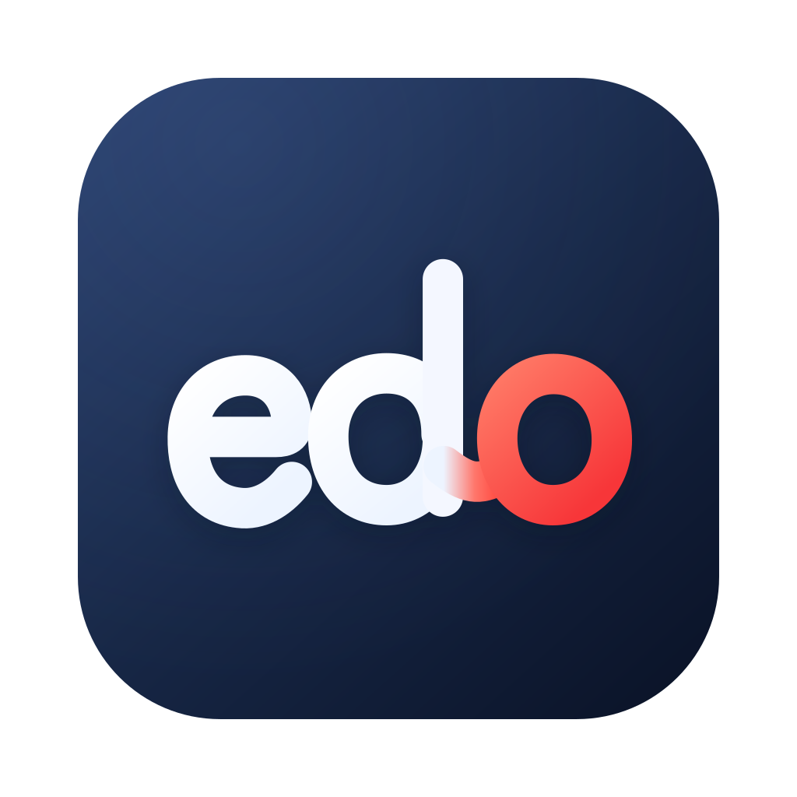
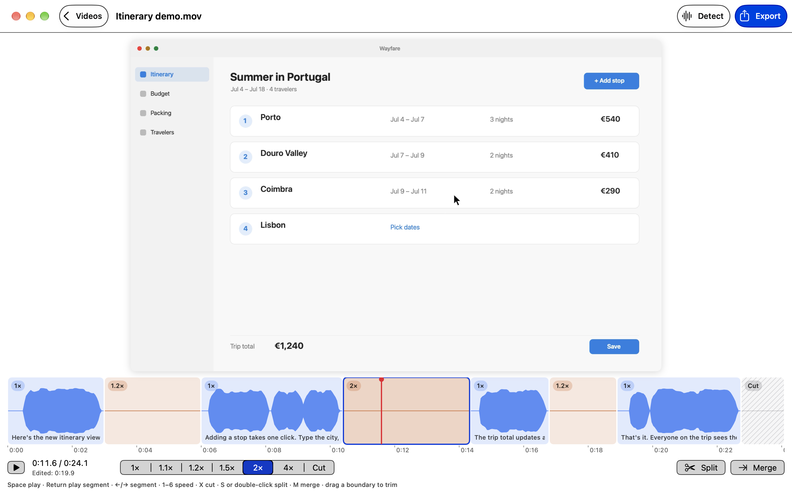
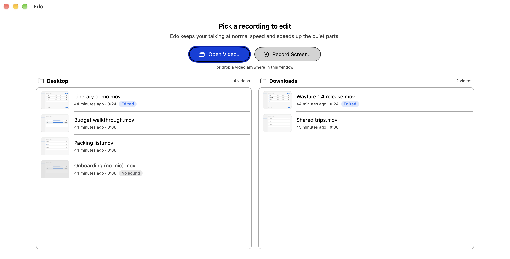

<p align="center"></p>

# Edo

A keyboard-driven macOS editor for screen recordings with a voice-over. Edo finds
where you talk, keeps your speech at normal speed and speeds up or cuts the quiet
parts. You fine-tune each part on the timeline, then export.

Edo also records the screen with the mic modes macOS offers in Control Center,
such as Voice Isolation, and opens each recording straight in the editor.



## Install

Edo needs macOS 26 and Xcode 26 (Swift 6.2).

```bash
brew install librsvg           # draws the app icon from assets/AppIcon.svg
scripts/make-signing-cert.sh   # a local certificate, so permissions survive rebuilds
scripts/bundle.sh              # builds Edo.app and installs it in ~/Applications
open ~/Applications/Edo.app
```

Open Edo.app, not the `edo` executable in `.build`: Finder runs a bare executable in
Terminal, and macOS then asks for the permissions on Terminal's behalf.

`swift run edo ~/Desktop/demo.mov` also opens the editor, but recording the screen
needs the app.

## Videos



The welcome screen lists the videos on your Desktop and in Downloads side by side,
newest first. Videos with a plan are marked Edited; videos without sound are dimmed
and marked No sound, since there's no speech to find. **Videos** in the title bar
goes back to this list; your edits are already saved. **Cmd+O** opens any other
video, and dropping a video on the window works too.

## Recording

**Record Screen…** (Cmd+Shift+R) shows your microphone's level and mic mode. Edo
records the mic through Apple's voice processing, so Control Center offers Standard,
Voice Isolation and Wide Spectrum for it; **Change…** opens that menu. **Choose Area…**
dims the screens: drag the area to record, drag inside it to move it, drag an edge
or a corner to resize it, or pick **Whole Screen**, then press Return. The last
area is remembered.

**Script** in the same toolbar shows a panel to paste what you want to say. Drag its top
to move it and its edges to resize it. The text grows to fill the panel, up to a limit,
and gets smaller when the script is long. It stays on
screen while you record but isn't in the video. Edo remembers the script, where you put
it and whether it's on.

While recording, a small panel shows the time, the mic level and mode, and **Stop**.
A dashed red line marks the recorded area. Edo's own windows stay out of the video.
Stop saves `Screen Recording <date> at <time>.mov` on the Desktop and opens it here
with the speech already found. **Start Over**, at the other end of the panel, saves
the take so far on the Desktop and starts a new recording of the same area.

## Editing

The timeline shows the audio waveform split into segments. Blue segments play at
normal speed, orange ones faster, striped ones are cut.

| Key | Action |
|---|---|
| Space | Play or pause the edited video |
| Return | Play only the selected segment, then return to its start |
| ← / → | Select the previous or next segment |
| 1 to 6 | Speed 1×, 1.1×, 1.2×, 1.5×, 2×, 4× |
| X | Cut the segment, or bring it back |
| S | Split at the playhead |
| M | Merge with the next segment |
| Cmd+Z | Undo |
| Cmd+E | Export to `<name>-edited.mov` next to the video (also in the title bar) |

Clicking the timeline moves the playhead and pauses; double-clicking splits the
segment there. Drag a boundary between two segments to trim them.

## How speech is found

1. Loudness is measured in the voice band (100 Hz–4 kHz), so hum and rumble don't count.
2. The quiet level is picked from the video itself: the cutoff between its background
   noise and your voice (Otsu's method on the loudness histogram).
3. Speech starts when audio gets louder than that level and continues until it drops
   6 dB below it. Loud bursts under 0.15 s, like clicks, are ignored.
4. macOS transcribes the audio on the device. A loud stretch counts as talking only when
   a word starts in it, and each speech segment's note is what you said there.
5. By default, Edo cuts detected pauses at the start and end and speeds up pauses between speech. The minimum pause is 1 s. A wholly quiet video stays playable.

**Detect** runs this again with your choice of words on or off, a fixed quiet level,
the pause length and the quiet-part speed. Opening a video with a plan file keeps
that plan; delete the file or use **Detect** to start over.

## The plan file

Every edit is saved to `<name>.plan.txt` next to the video:

```
   0.00    3.40  1      # speech
   3.40    5.80  1.2    # quiet
  10.60   14.50  1.5    # clicking to the quote
  14.50   15.50  1      # spinner: keep a second
  15.50   28.00  0      # spinner: cut
```

Each line is `start end speed`, in seconds of the original video. Speed 0 cuts the
segment, gaps between lines are cut too, and text after `#` is a note. Edo reloads
the file within a second of it changing, so another program, such as an AI agent,
can edit it while the editor is open. A mistake in the file shows a message naming
the line, and the editor keeps the last good plan.

## Command line

```bash
edo detect demo.mov          # print the detected plan without saving it
edo plan demo.mov            # detect speech, write demo.plan.txt (--force replaces it)
edo render demo.mov [out]    # export the plan without opening the editor
```

`detect` and `plan` take `--loudness` (ignore words), `--threshold -40`, `--pause 1.5`
and `--speed 1.5`.

## Development

`swift test` runs the tests.

`EDO_SNAPSHOT=out.png edo demo.mov` saves a picture of the window after loading and
quits: a real screenshot when Edo may record the screen, otherwise drawn offscreen.
`EDO_SNAPSHOT_WIDTH` and `EDO_SNAPSHOT_HEIGHT` size the window and `EDO_SNAPSHOT_TIME`
moves the playhead first. `EDO_SNAPSHOT_RECORD=folder` also saves the recording
screens: the setup sheet in each state, the recording panel and the area overlay.
`EDO_RECENT_FOLDERS=/a:/b` shows two other folders on the welcome screen.

`EDO_RECORD_TEST=3` records the whole main screen for 3 seconds, prints each step,
then stops and opens the recording. Run it on the app so it has the permissions:
`open -n --env EDO_RECORD_TEST=3 --stderr /dev/stdout ~/Applications/Edo.app`.

The screenshots show made-up recordings of a fake trip planner, with a voice-over
from the macOS `say` command: `swift scripts/demo-video.swift out.mov [itinerary|budget|packing]`
makes one (it needs ffmpeg).

## License

[MIT](LICENSE)
